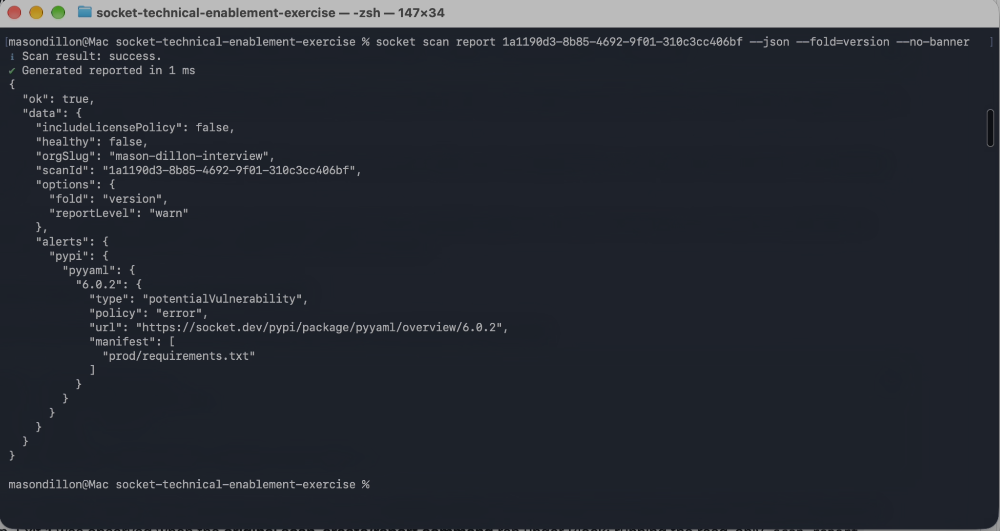
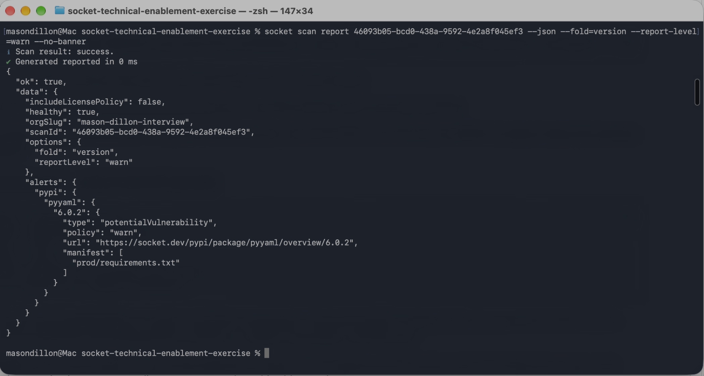
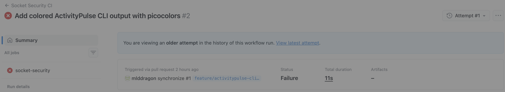
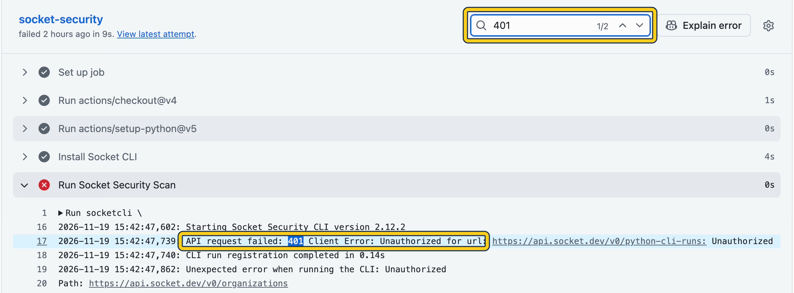
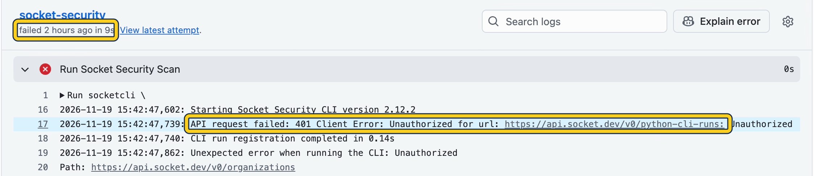
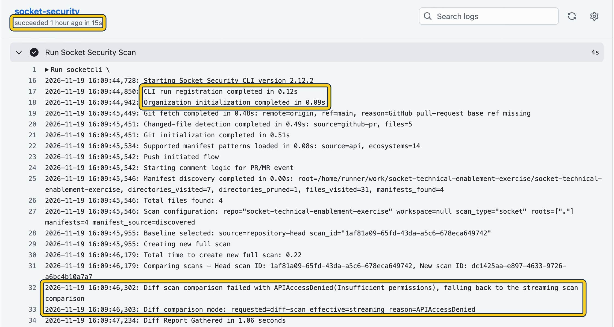

# Part III — Guided Hands-on Lab: A Red Build Is Not Always a Security Block

**Duration:** 25 minutes (maximum 30)  
**Audience:** New Socket SE, TAM, or Support engineer  
**Project:** [ActivityPulse](https://github.com/mlddragon/socket-technical-enablement-exercise), a Node.js + Python activity-reporting CLI  
**Outcome:** Diagnose a policy-enforced Block, a non-blocking Warn, and an authentication failure; give a defensible, safe customer response.

## The story — Courtney's release decision (0–3 minutes)

Courtney is the **lead software engineer** for ActivityPulse. They build features alongside their team and coach less-experienced engineers through reviews, releases, and production issues. Their team has recently added Socket to the software supply-chain review process.

ActivityPulse imports activity records using Python's PyYAML library and presents results through a Node.js CLI. Courtney's team is preparing a release when two apparently contradictory reports arrive. One Socket CLI scan says **unhealthy** and blocks the dependency under policy. A GitHub Actions job also turns red, but its log shows **401 Unauthorized**, not a package alert. Meanwhile, another scan of the same PyYAML dependency reports only a warning.

Courtney must decide whether a dependency needs security review, the CI configuration needs repair, or both. They cannot responsibly tell the team to bypass controls just because a build is red. Courtney asks a new team member to investigate the conflicting results and recommend what the team should do next.

### Before you begin

**What you will do:** Inspect saved Socket scan evidence and GitHub Actions logs; classify each result; communicate a safe next step. No changes to code, tokens, or policy are required.

**Why:** The saved reports let you inspect the policy decisions from the original experiment. The original policy was restored to Balanced / Inherit after the experiment, so re-running a new scan today is **not** expected to reproduce the same Block.

**Have ready:** A terminal and a notes area; to retrieve saved scans directly, use an already-authorized Socket CLI v1.15.x. To inspect the GitHub Actions example, use the direct workflow link in Activity 3. The lab contains all case evidence needed to complete the exercises, even when you lack access to the original organization's scans. To fetch historical reports, the token needs `full-scans:list` and `security-policy:read`. Do not request or paste token values.

**If you lack Socket org access:** Use the screenshots and log excerpts in the **Expected result** sections. Complete the classification and handoff anyway. Do not create an account, modify permissions, or change organization policy just to run this lab.

**Safety:** Do not disclose credentials, install unknown packages, run malicious code, or change organization-wide policy. The lab analyzes past results rather than forcing a fresh Block.

---

## Activity 1 — Find the policy block (3–10 minutes)

### What you are going to do
You will inspect the historical **Block** scan for PyYAML and identify the exact evidence that makes it a security-policy decision rather than an infrastructure error.

### Why you are doing it
A red CI indicator alone does not say *why* something failed. You need the package, finding, effective policy, scan health, and observed command outcome before advising a customer or release team.

### Steps to complete

1. Open your notes and locate the worksheet in Activity 4. If you lack authorized Socket CLI access, skip the command and use the screenshot under **Expected result**.
2. **If you have authorized Socket CLI access**, run this read-only command:

   ~~~bash
   socket scan report 1a1190d3-8b85-4692-9f01-310c3cc406bf --json --fold=version --no-banner
   ~~~

   If it fails because you lack organizational access, stop that path and use the provided historical evidence below. Do not regenerate the token or change policy.
3. Find the package and version, alert type, policy action, and `healthy` value in the report or screenshot.
4. Record your findings in **Case A** of the worksheet at the end. In the **Safe next action** cell, describe what you would ask the dependency owner or security reviewer to assess before the release proceeds. For context, ActivityPulse loads YAML with `yaml.safe_load`. Ask whether the finding applies to that code path and what remediation the owner recommends.

### Expected result — what it should look like

Find `data.healthy: false` near the top and `policy: error` under the PyYAML 6.0.2 `potentialVulnerability` finding. The report was generated successfully (`ok: true`) and describes an unhealthy scan. The original combined `scan create --report` command exited **1** under Block. The screenshot shows a later read-only `scan report` retrieval.

**Checkpoint:** You should be able to say, “This result was blocked by policy because Socket evaluated a specific PyYAML finding.” You should **not** conclude that PyYAML is malware, or advise disabling the policy to ship.

---

## Activity 2 — Find a warning that did not block (10–15 minutes)

### What you are going to do
You will examine a historical **Warn** scan of the same package and compare its action, health status, and report visibility with Activity 1.

### Why you are doing it
Security detection, visibility thresholds, and enforcement are separate concepts. A warning can be present even when the process succeeds and an Error-only report appears empty.

### Steps to complete

1. Open your notes to **Case B**. If you lack authorized Socket CLI access, skip the command and use the screenshot under **Expected result**.
2. **If you have authorized Socket CLI access**, run this read-only command:

   ~~~bash
   socket scan report 46093b05-bcd0-438a-9592-4e2a8f045ef3 --json --fold=version --report-level=warn --no-banner
   ~~~

   If you are working from case evidence, read the expected result below instead.
3. Find PyYAML 6.0.2 and its `potentialVulnerability` alert in the report or screenshot under **Expected result**.
4. **Compare the two reports side by side** using the table under **Expected result**. Find **`healthy`** near the top of each report and **`policy`** under the PyYAML alert. Confirm that the package/version and finding type are the same. Record the differences in **Case B** of the worksheet, and answer: **Which CLI option makes the warning visible?**

### Expected result — what it should look like

Look for `healthy: true` and `policy: warn`. The original combined `scan create --report` command exited **0**. The read-only command above uses `--report-level=warn` to show warnings that an Error-only report can omit.

#### Side-by-side comparison for Step 4

| Field | Block | Warn |
|---|---|---|
| Original terminal report |  |  |
| **`healthy`** | **`false`** | **`true`** |
| **`policy`** | **`error`** | **`warn`** |

Select either screenshot to open it at full size. Look under `data` for `healthy` and under `alerts → pypi → pyyaml → 6.0.2` for the alert's `policy`.

**Checkpoint:** You should be able to say, “Socket detected a finding, but the selected action warned rather than failing the scan.” Do not change the organization's current policy to try to reproduce this older result.

---

## Activity 3 — Investigate the failed GitHub Actions job (15–21 minutes)

### What you are going to do
You will inspect a real failed CI attempt, locate the **first meaningful error**, and compare it with the later successful scan.

### Why you are doing it
Courtney's team needs to know whether to assign this issue to a dependency/security owner or to the CI/credential owner. Different causes require different fixes.

### Steps to complete

1. Open the [Attempt 1 summary](https://github.com/mlddragon/socket-technical-enablement-exercise/actions/runs/44557864628/attempts/1) and select **socket-security** under **All jobs**. You can also open the [Attempt 1 job directly](https://github.com/mlddragon/socket-technical-enablement-exercise/actions/runs/44557864628/job/135678730253) or pick Attempt 1 from the [workflow run](https://github.com/mlddragon/socket-technical-enablement-exercise/actions/runs/44557864628). If you can't open either job's logs within a minute, use the screenshots and excerpts here.

   

2. In the **socket-security** job, confirm that checkout, Python setup, and CLI installation succeeded. Expand **Run Socket Security Scan**, then enter `401` in the job's **Search logs** box. Read the first highlighted match. It names `/v0/python-cli-runs` and says **Unauthorized**. Clear the search to read the surrounding trace and find `/v0/organizations` and exit code **3**.

   

3. Open the [Attempt 4 job](https://github.com/mlddragon/socket-technical-enablement-exercise/actions/runs/44557864628/job/135696762163) and expand **Run Socket Security Scan**. Compare the two jobs below. In Attempt 4, find organization initialization, the streaming comparison fallback, and the successful job status. Then find **No issues found** later in the log or in the excerpt under **Expected result**. Both attempts logged “CLI run registration completed,” so check what happened after that message.

   | Attempt 1 — Failed | Attempt 4 — Succeeded |
   |---|---|
   |  |  |
   | **HTTP 401** before dependency analysis completed | **Organization initialized** and the job passed after switching to **streaming comparison** |

   Select either screenshot to open it at full size.

4. Record Attempt 1 in **Case C**. In your notes below the worksheet, explain whether Attempt 4's fallback caused the job to fail and name one credential check the CI owner can perform without revealing the secret.

### Expected result — what it should look like

**Attempt 1 — failed authentication (selected log lines, timestamps removed):**

~~~text
Starting Socket Security CLI version 2.12.2
API request failed: 401 Client Error: Unauthorized for url: https://api.socket.dev/v0/python-cli-runs: Unauthorized
CLI run registration completed in 0.14s
Path: https://api.socket.dev/v0/organizations
Process completed with exit code 3.
~~~

**Attempt 4 — successful scan (selected log lines, timestamps removed):**

~~~text
CLI run registration completed in 0.12s
Organization initialization completed in 0.09s
Diff scan comparison failed with APIAccessDenied(Insufficient permissions), falling back to the streaming scan comparison
Diff comparison mode: requested=diff-scan effective=streaming reason=APIAccessDenied
No issues found
~~~

GitHub Actions marked Attempt 4 **successful**. In Attempt 1, checkout, Python setup, and CLI installation passed before the scan step failed.

The CI owner corrected the repository secret to use the actual Socket API token. Other attempts also changed scopes, so the evidence does not establish that wider scopes fixed authentication. For your handoff, ask the CI owner to verify that the workflow references the intended repository secret and that it contains an authorized token. Keep the value out of logs, notes, and messages.

**Checkpoint:** Identify Attempt 1 as authentication failure before dependency analysis completed. Confirm that Attempt 4 completed with a successful job after falling back to streaming comparison.

---

## Activity 4 — Advise Courtney's team (21–25 minutes)

### What you are going to do
You will complete a short diagnosis worksheet and prepare customer-ready explanations for all three cases.

### Why you are doing it
Courtney must turn raw scan details into a safe engineering decision. The team needs the issue owner, supporting evidence, and the next action—not just “the build is red.”

### Steps to complete

1. Complete the three worksheet rows below. If you already recorded evidence during Activities 1–3, reuse your notes. Pair each original exit code you cite with the finding or HTTP error that explains it.
2. Under the table, write **two sentences for each case**. Sentence 1 must state the actual evidence and the outcome. Sentence 2 must identify the next safe step and its owner (security/dependency review or CI/credentials). For example, a useful opening is, “The report identified PyYAML 6.0.2 and applied the Block policy; the scan was unhealthy.” Write your own next-action sentence.
3. Read your three updates aloud as though you're briefing Courtney and their engineering team. Keep each explanation under 20 seconds.
4. Review each update against this checklist: You named the evidence, distinguished policy from infrastructure, assigned the right follow-up owner, and did not claim malware, expose credentials, or advise bypassing policy.

### Expected result — what it should look like

| Case | Scan analysis completed? | Evidence to cite | Classification | Safe next action |
|---|---|---|---|---|
| A — Block | Your answer | Your answer | Your answer | Your answer |
| B — Warn | Your answer | Your answer | Your answer | Your answer |
| C — 401 | Your answer | Your answer | Your answer | Your answer |

**Expected worksheet outcome:** **Case A:** completed evaluation; PyYAML `potentialVulnerability`, `policy: error`, unhealthy; policy-enforced Block; dependency/security owner investigates package behavior and policy. **Case B:** completed evaluation; same package, `policy: warn`, healthy; non-blocking warning; have the dependency owner review the finding and document the release decision. Use the Warn reporting threshold to keep the finding visible. **Case C:** no completed dependency evaluation in failed attempt; HTTP 401 during Socket API calls; authentication/tooling failure; CI owner validates the correct repository-secret value and permissions without revealing it.

**Self-check:** A should be an evaluated policy Block; B should be a non-blocking Warn; C should be authentication/tooling failure. For A, start with a dependency and policy review. For C, start with the correct credential and CI configuration **without exposing secret contents**. Bonus: identify attempt 4's streaming fallback as a remaining narrower permissions issue, not a failed scan.

## The story concludes — Courtney makes the call

Courtney now has three different engineering outcomes instead of one vague category called “Socket failed.” Their original PyYAML Block reached policy evaluation and requires an accountable security decision. The Warn result surfaces the same type of finding without stopping the scan. The GitHub Actions failure happened earlier, during authentication, and was repaired by correcting the credential stored in the CI secret; the later scan passed even though it fell back to a different comparison mode.

With the evidence separated, Courtney can send the dependency finding to the appropriate security reviewer and the credential issue to the CI owner. Their team does not need to bypass policy to fix authentication, and it does not need to troubleshoot credentials when a finding has actually been blocked. The important lesson is now part of Courtney's release process: **first identify where the operation failed, then decide who should act and why.**

---

## Facilitator notes (not learner steps)

- **Facilitator answer key:** A = package PyYAML 6.0.2, `potentialVulnerability`, policy `error`, unhealthy, original exit 1. B = same finding, `warn`, healthy, original exit 0, visible at `--report-level=warn`. C = Python CLI HTTP 401 before scan completion, original exit 3; actual token value correction resolved it. Attempt 4 succeeded with streaming comparison after a diff permission fallback.
- **If learner lacks org access:** Use the supplied screenshots and log excerpts without asking for credentials. GitHub job logs remain the main clickable exercise; if the attempt selector is unavailable, provide sanitized excerpts rather than fabricating live access. Do not score an access constraint as learner incompetence.
- **Timing:** Narrative/orientation 3 min; Block 7; Warn 5; auth failure/success comparison 6; customer handoff 4 = **25 min**.
- **Do not conflate:** A CLI `scan report` inspection with the original `scan create --report` exit code; GitHub App PR comments with Python CI job status; a diff-scan fallback with total scan failure; detected indicators with confirmed maliciousness.
- **Assessment:** Use the separately authored [practical readiness check](part-iii-readiness-check.md). Learner meets readiness only after they can diagnose from evidence, communicate safely, and choose appropriate next actions. A 5–7-minute post-lab readiness assessment is separate from the 25-minute lab; if the full teaching session must stay within 30 minutes, use its condensed 5-minute scenario check.
- **References:** [Part I briefing](part-i-briefing.md), [detailed execution log](part-i-walkthrough.md), [GitHub Actions run](https://github.com/mlddragon/socket-technical-enablement-exercise/actions/runs/44557864628).
