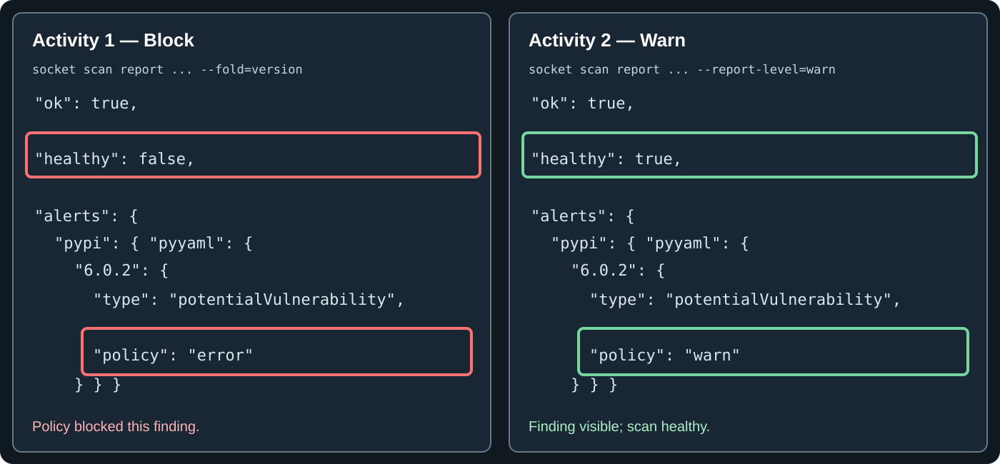

# Part III — Guided Hands-on Lab: A Red Build Is Not Always a Security Block

**Duration:** 25 minutes (maximum 30)  
**Audience:** New Socket SE, TAM, or Support engineer  
**Project:** [ActivityPulse](https://github.com/mlddragon/socket-technical-enablement-exercise), a Node.js + Python activity-reporting CLI  
**Outcome:** Diagnose a policy-enforced Block, a non-blocking Warn, and an authentication failure; give a defensible, safe customer response.

## The story — Courtney's release decision (0–3 minutes)

Courtney is the **lead software engineer** for ActivityPulse. They build features alongside their team and coach less-experienced engineers through reviews, releases, and production issues. Their team has recently added Socket to the software supply-chain review process.

ActivityPulse imports activity records using Python's PyYAML library and presents results through a Node.js CLI. Courtney's team is preparing a release when two apparently contradictory reports arrive. One Socket CLI scan says **unhealthy** and blocks the dependency under policy. A GitHub Actions job also turns red, but its log shows **401 Unauthorized**, not a package alert. Meanwhile, another scan of the same PyYAML dependency reports only a warning.

Courtney must decide whether a dependency needs security review, the CI configuration needs repair, or both. They cannot responsibly tell the team to bypass controls just because a build is red. Courtney has asked you to investigate this. Work from the evidence, tell the team what it actually means, and choose the next action.

### Before you begin

**What you will do:** Inspect saved Socket scan evidence and GitHub Actions logs; classify each result; communicate a safe next step. No changes to code, tokens, or policy are required.

**Why:** These historical results are real and reproducible as **read-only investigations**. The original policy was restored to Balanced / Inherit after the experiment, so re-running a new scan today is **not** expected to reproduce the same Block.

**Have ready:** A terminal and a notes area; to retrieve saved scans directly, use an already-authorized Socket CLI v1.15.x. To inspect the GitHub Actions example, use the direct workflow link in Activity 3. The lab contains all case evidence needed to complete the exercises, even when you lack access to the original organization's scans. To fetch historical reports, the token needs `full-scans:list` and `security-policy:read`. Do not request or paste token values.

**If you lack Socket org access:** Use the **Provided evidence** under each activity. Complete the classification and handoff anyway. Do not create an account, modify permissions, or change organization policy just to run this lab.

**Safety:** Do not disclose credentials, install unknown packages, run malicious code, or change organization-wide policy. The lab analyzes past results rather than forcing a fresh Block.

---

## Activity 1 — Find the policy block (3–10 minutes)

### What you are going to do
You will inspect the historical **Block** scan for PyYAML and identify the exact evidence that makes it a security-policy decision rather than an infrastructure error.

### Why you are doing it
A red CI indicator alone does not say *why* something failed. You need the package, finding, effective policy, scan health, and observed command outcome before advising a customer or release team.

### Steps to complete

1. Open a terminal where Socket CLI is installed. If you do not have CLI access, continue using the supplied evidence in this activity; you can still complete every question.
2. Copy this saved **Block** scan ID: **`1a1190d3-8b85-4692-9f01-310c3cc406bf`**.
3. **If you have authorized Socket CLI access**, run this read-only command:

   ~~~bash
   socket scan report 1a1190d3-8b85-4692-9f01-310c3cc406bf --json --fold=version --no-banner
   ~~~

   If it fails because you lack organizational access, stop that path and use the provided historical evidence below. Do not regenerate the token or change policy.
4. In the report—or in **Provided evidence** immediately below—locate four details: the package/version, alert type, policy action, and `healthy` result. The highlighted comparison graphic in Activity 2 shows exactly where the health and policy values appear.
5. Record your findings in **Case A** of the worksheet at the end. In the **Next action** cell, describe what you would ask the dependency owner or security reviewer to assess before the release proceeds.

### Expected result — what it should look like

**Provided evidence (from the verified historical experiment; shortened for teaching):**

~~~text
Package:  pypi/pyyaml/6.0.2
Finding:  potentialVulnerability
Policy:   error  (Block)
Healthy:  false
Original combined create/report process exit code: 1
~~~

**Visual reference:** Activity 2 includes a side-by-side annotated excerpt showing the key lines from the Block and Warn terminal reports. The original Activity 1 screenshot will be inserted here once the PNG is uploaded into the repository; meanwhile the provided evidence below is sufficient to complete the task.

The explicit **`policy: error`**, the named package finding, and **`healthy:false`** demonstrate that analysis reached a policy-enforcement decision. Exit **1** was observed when the **original scan-create/report command** ran under Block; running the read-only `scan report` command above is not a repeat of that process exit test.

**Checkpoint:** You should be able to say, “This result was blocked by policy because Socket evaluated a specific PyYAML finding.” You should **not** conclude that PyYAML is malware, or advise disabling the policy to ship.

---

## Activity 2 — Find a warning that did not block (10–15 minutes)

### What you are going to do
You will examine a historical **Warn** scan of the same package and compare its action, health status, and report visibility with Activity 1.

### Why you are doing it
Security detection, visibility thresholds, and enforcement are separate concepts. A warning can be present even when the process succeeds and an Error-only report appears empty.

### Steps to complete

1. Keep your terminal and notes area open. This activity uses a different saved scan of the same dependency, so you do not need to open another document.
2. Copy the historical **Warn** scan ID **`46093b05-bcd0-438a-9592-4e2a8f045ef3`**.
3. If you have authorized CLI access, run:

   ~~~bash
   socket scan report 46093b05-bcd0-438a-9592-4e2a8f045ef3 --json --fold=version --report-level=warn --no-banner
   ~~~

   If you are working from case evidence, read the expected result below instead.
4. Find the package and `potentialVulnerability` alert. Look for `policy: warn` and `healthy:true`. Compare the fields with the highlighted reference below; if you lack Socket access, use the supplied values.
5. **Compare the two reports side by side** using the annotated visual below. Locate the highlighted **`healthy`** field in each column, then the highlighted **`policy`** field. Confirm that the package/version and finding type are the same. Record the differences in **Case B** of the worksheet, and answer: **Which CLI option makes the warning visible?**

### Expected result — what it should look like

~~~text
Package:  pypi/pyyaml/6.0.2
Finding:  potentialVulnerability
Policy:   warn
Healthy:  true
Original combined scan process exit code: 0
Report visibility: --report-level=warn
~~~

**Side-by-side evidence comparison (highlighted):** The visual below reproduces the important lines from the two verified terminal reports. The colored outlines identify the **health** and **effective policy** values; this is an annotated excerpt, not a new scan or a substitute for the actual CLI output.

| What to compare | **Activity 1 — Block** | **Activity 2 — Warn** |
|---|---|---|
| Package | `pypi/pyyaml/6.0.2` | `pypi/pyyaml/6.0.2` |
| Alert type | `potentialVulnerability` | `potentialVulnerability` |
| **Policy action** | **`error` (Block)** | **`warn`** |
| **Scan health** | **`false`** | **`true`** |
| Original combined command exit | `1` | `0` |

The warning is **not a policy Block**. Its original combined create/report command exited **0**. In this exercise, using an Error-only threshold could hide warnings from the displayed alert summary; `--report-level=warn` includes them.

**Checkpoint:** You should be able to say, “Socket detected a finding, but the selected action warned rather than failing the scan.” Do not change the organization's current policy to try to reproduce this older result.

---

## Activity 3 — Investigate the failed GitHub Actions job (15–21 minutes)

### What you are going to do
You will inspect a real failed CI attempt, locate the **first meaningful error**, and compare it with the later successful scan.

### Why you are doing it
Courtney's team needs to know whether to assign this issue to a dependency/security owner or to the CI/credential owner. Different causes require different fixes.

### Steps to complete

1. Open the [actual Socket Security CI workflow run](https://github.com/mlddragon/socket-technical-enablement-exercise/actions/runs/44557864628) in GitHub. If GitHub is unavailable or you lack access, use the complete sanitized excerpts below rather than looking for background project documents.
2. Near the workflow-run heading, locate **Run attempt** (or the attempts/history selector), then choose **Attempt 1**. If the selector is not visible, examine the run's attempt history; do not spend more than one minute hunting for a UI control. The relevant evidence is also printed below.
3. Open the **socket-security** job. Expand **Run Socket Security Scan** in the step list. The earlier **checkout**, **Python setup**, and **Socket CLI installation** steps should show success.
4. In the scan step, find the earliest `401 Client Error: Unauthorized` entry. Note the requested endpoint `/v0/python-cli-runs`; the subsequent trace also references `/v0/organizations`. Find **Process completed with exit code 3**.
5. In **Case C** of the worksheet, record the failing stage and the HTTP status. Explain why this evidence does **not** establish a malicious dependency or a policy Block.
6. Return to the same workflow run's attempt selector, choose **Attempt 4**, and expand **Run Socket Security Scan**. If attempts are inaccessible, use the provided successful-run excerpt. Locate:
   - Successful **CLI run registration** and **Organization initialization**.
   - **No issues found** and a successful job.
   - The warning: **Diff scan comparison failed with APIAccessDenied(Insufficient permissions), falling back to the streaming scan comparison**.
7. In **Case C** of the worksheet, answer: **Did the attempt-4 fallback cause the job to fail?** What steps succeeded despite that warning? Include one safe way to investigate a wrong or missing credential without revealing it.

### Expected result — what it should look like

**Attempt 1 — failed authentication (sanitized excerpt):**

~~~text
Starting Socket Security CLI version 2.12.2
API request failed: 401 Client Error: Unauthorized
  .../v0/python-cli-runs
Unexpected error when running the CLI: Unauthorized
  .../v0/organizations
Process completed with exit code 3
~~~

**Attempt 4 — successful scan with limited comparison mode (sanitized excerpt):**

~~~text
CLI run registration completed
Organization initialization completed
Diff scan comparison failed: insufficient permissions
Diff comparison mode: effective=streaming
No issues found
Job conclusion: success
~~~

The historical troubleshooting established that the original CI secret contained a different `SHA512-...==` value, while the working credential was the actual Socket API token beginning with `sktsec_`. Changing the secret value resolved the **401**. Additional scope changes were also tried, so you must not claim the expanded scopes alone were the cause or solution. **Never request or expose the complete token.**

**Visual guidance for GitHub Actions:** In the job steps, compare the checkmarks beside **checkout**, **Python setup**, and **Socket CLI installation** with the failed **Run Socket Security Scan** step in attempt 1. In attempt 4, all job steps succeed; the text still includes a non-fatal permission fallback. A screenshot of these log views can be placed directly beneath this paragraph when available, but the embedded excerpts above give you everything needed for the diagnosis.

**Checkpoint:** You should distinguish **failed authentication before analysis** from **completed analysis with a non-fatal fallback**. A non-blocking warning in a successful job is not the same thing as a 401.

---

## Activity 4 — Advise Courtney's team (21–25 minutes)

### What you are going to do
You will complete a short diagnosis worksheet and prepare customer-ready explanations for all three cases.

### Why you are doing it
Courtney must turn raw scan details into a safe engineering decision. The team needs the issue owner, supporting evidence, and the next action—not just “the build is red.”

### Steps to complete

1. Copy the five-column worksheet immediately below into your notes. Fill all three rows with evidence from Activities 1–3. Use the **original observed exit code** only alongside the actual scan finding or HTTP error; never use the number as your sole explanation.
2. Under the table, write **two sentences for each case**. Sentence 1 must state the actual evidence and the outcome. Sentence 2 must identify the next safe step and its owner (security/dependency review or CI/credentials). For example, a useful opening is, “The report identified PyYAML 6.0.2 and applied the Block policy; the scan was unhealthy.” Write your own next-action sentence.
3. Read your three updates aloud as though you're briefing Courtney and their engineering team. Keep each explanation under 20 seconds.
4. Review each update against this checklist: You named the evidence, distinguished policy from infrastructure, assigned the right follow-up owner, and did not claim malware, expose credentials, or advise bypassing policy.

### Expected result — what it should look like

| Case | Scan analysis completed? | Evidence to cite | Classification | Safe next action |
|---|---|---|---|---|
| A — Block | Your answer | Your answer | Your answer | Your answer |
| B — Warn | Your answer | Your answer | Your answer | Your answer |
| C — 401 | Your answer | Your answer | Your answer | Your answer |

**Expected worksheet outcome:** **Case A:** completed evaluation; PyYAML `potentialVulnerability`, `policy: error`, unhealthy; policy-enforced Block; dependency/security owner investigates package behavior and policy. **Case B:** completed evaluation; same package, `policy: warn`, healthy; non-blocking warning; explain risk and report-level visibility. **Case C:** no completed dependency evaluation in failed attempt; HTTP 401 during Socket API calls; authentication/tooling failure; CI owner validates the correct repository-secret value and permissions without revealing it.

**Self-check:** A should be an evaluated policy Block; B should be a non-blocking Warn; C should be authentication/tooling failure. For A, start with a dependency and policy review. For C, start with the correct credential and CI configuration **without exposing secret contents**. Bonus: identify attempt 4's streaming fallback as a remaining narrower permissions issue, not a failed scan.

## The story concludes — Courtney makes the call

Courtney now has three different engineering outcomes instead of one vague category called “Socket failed.” Their original PyYAML Block reached policy evaluation and requires an accountable security decision. The Warn result surfaces the same type of finding without stopping the scan. The GitHub Actions failure happened earlier, during authentication, and was repaired by correcting the credential stored in the CI secret; the later scan passed even though it fell back to a different comparison mode.

With the evidence separated, Courtney can send the dependency finding to the appropriate security reviewer and the credential issue to the CI owner. Their team does not need to bypass policy to fix authentication, and it does not need to troubleshoot credentials when a finding has actually been blocked. The important lesson is now part of Courtney's release process: **first identify where the operation failed, then decide who should act and why.**

---

## Facilitator notes (not learner steps)

- **Facilitator answer key:** A = package PyYAML 6.0.2, `potentialVulnerability`, policy `error`, unhealthy, original exit 1. B = same finding, `warn`, healthy, original exit 0, visible at `--report-level=warn`. C = Python CLI HTTP 401 before scan completion, original exit 3; actual token value correction resolved it. Attempt 4 succeeded with streaming comparison after a diff permission fallback.
- **If learner lacks org access:** Use supplied evidence blocks without asking for credentials. GitHub job logs remain the main clickable exercise; if the attempt selector is unavailable, provide sanitized excerpts rather than fabricating live access. Do not score an access constraint as learner incompetence.
- **Timing:** Narrative/orientation 3 min; Block 7; Warn 5; auth failure/success comparison 6; customer handoff 4 = **25 min**.
- **Do not conflate:** A CLI `scan report` inspection with the original `scan create --report` exit code; GitHub App PR comments with Python CI job status; a diff-scan fallback with total scan failure; detected indicators with confirmed maliciousness.
- **Assessment:** Use the separately authored [practical readiness check](part-iii-readiness-check.md). Learner meets readiness only after they can diagnose from evidence, communicate safely, and choose appropriate next actions. A 5–7-minute post-lab readiness assessment is separate from the 25-minute lab; if the full teaching session must stay within 30 minutes, use its condensed 5-minute scenario check.
- **References:** [Part I briefing](part-i-briefing.md), [detailed execution log](part-i-walkthrough.md), [GitHub Actions run](https://github.com/mlddragon/socket-technical-enablement-exercise/actions/runs/44557864628).

